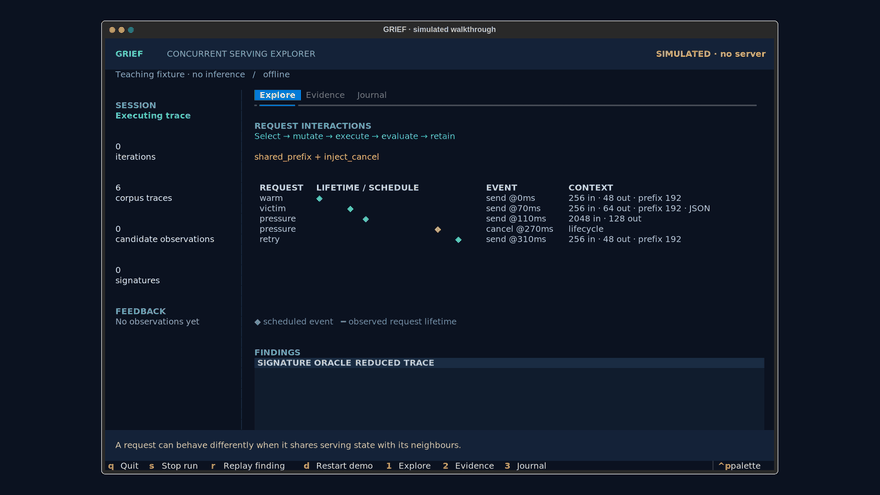

# GRIEF

**Greybox fuzzing of concurrent LLM serving systems.**

GRIEF searches for failures that emerge when requests overlap, share cached
state, compete for resources, or are cancelled mid-flight. Its input is a
timed request trace. Serving-state feedback guides mutation and corpus
selection; oracles and controlled replay separate observations from findings.

The client supports **vLLM and SGLang**, with adapters for LoRA, speculative
decoding, MoE, and vLLM prompt embeddings. Servers and model weights are
installed separately.


[Watch the walkthrough]([docs/media/demo.mp4](https://github.com/user-attachments/assets/12a14890-077d-471f-83ff-59b7692a8cd1)) · [Quick start](docs/quickstart.md) ·
[Architecture](docs/architecture.md) · [Interpreting results](docs/results.md)

The walkthrough is a **simulated teaching example**: it makes no inference
requests and makes no claim about a vulnerability in a particular engine.

## Install

Python 3.11 or newer:

```bash
git clone https://github.com/Faultline-project/GRIEF.git
cd GRIEF
python -m venv .venv
source .venv/bin/activate
pip install '.[tui]'
grief demo
```

Use `pip install .` for the headless client. Add `.[telemetry]` for optional
NVML monitoring and vLLM KV events. Seeds ship inside the package, so commands
also work outside the checkout.

## Run against your server

Start an inference server separately, then connect from its host or another
machine that can reach it:

```bash
grief tui --base-url http://localhost:8000 --max-iterations 100
grief run --base-url http://localhost:8000 --max-iterations 100
# SGLang
grief run --sglang --base-url http://localhost:30000 --max-iterations 100
```

The client discovers the model through `/v1/models`. Scheduler metrics come
from the server's `/metrics`; local GPU memory readings are opt-in via
`--local-gpu-metrics` and are appropriate only when client and server share
the monitored GPU. `--mock-monitor` disables telemetry; it does not simulate
an inference server. Use `grief demo` for an offline walkthrough.

## Inspect and replay

Runs create a unique directory under `runs/`, with the corpus, findings and a
versioned `events.jsonl` stream. The TUI shows scheduled events and observed
request lifetimes, mutations, feedback, finding evidence and confirmation
records. It counts signatures, not independently confirmed root causes.

```bash
grief inspect runs/<run>
grief tui --watch runs/<run>
grief replay runs/<run>/findings/<finding>.json \
  --base-url http://localhost:8000 --runs 3 --output replay.json
```

Replay uses the same request executor and contract oracles. For output
divergence and other relational findings, direct replay reports
`inconclusive`; use the controlled confirmation workflow described in
[results](docs/results.md). Keep the original engine, model and feature flags.

TUI keys: `1` Explore, `2` Evidence, `3` Journal, `Enter` inspect selected
finding, `s` stop, `r` replay a selected live finding after stopping, `q` quit.
`d` restarts the simulated demo. Recommended terminal size: 120 × 40 or larger.

## Development

```bash
pip install -e '.[tui,telemetry,dev]'
python -m pytest tests -q
python -m build
```

This repository contains the reusable tool. Paper evaluation matrices,
ablation policies, cluster job scripts and historical campaign results are
kept in the separate research artifact. The implementation remains available
under `fuzzer/`; `python -m fuzzer` is a compatible headless entry point.

Apache-2.0. See [LICENSE](LICENSE) and [NOTICE](NOTICE).
